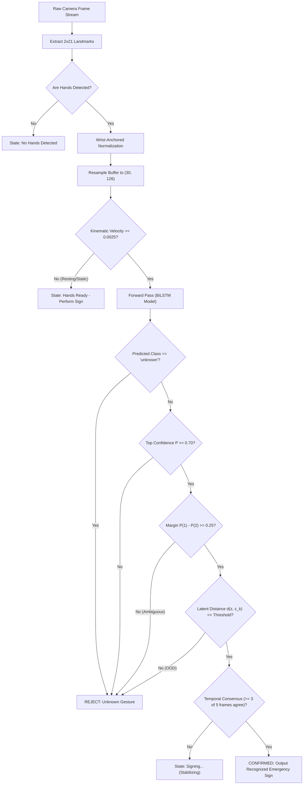

# 🤟 Hand-Independent Indian Sign Language (ISL) Emergency Gesture Recognition System with Multi-Tier Unknown Rejection

An end-to-end, real-time Computer Vision and Deep Learning framework designed to recognize critical **Indian Sign Language (ISL) emergency gestures** from live video and webcam feeds. The system is built upon the foundational methodology of **"LSTM-Based Recognition of Sign Language" (IC3 2024)** and substantially advanced with:
1. **True Bilateral Hand Independence** (equal accuracy for Left-Handed and Right-Handed signers).
2. **Multi-Tier Out-of-Distribution (OOD) & Unknown Gesture Rejection** (preventing forced misclassifications).
3. **Ergonomic Real-Time Interface with Dual-Hand Tracking & Dedicated Bottom Dashboard**.
4. **Synchronized Terminal Telemetry & Automated Diagnostic Suite**.

---

## 📑 Table of Contents
1. [Project Overview & Motivation](#-project-overview--motivation)
2. [Emergency Sign Vocabulary](#-emergency-sign-vocabulary)
3. [Key Scientific & Engineering Contributions](#-key-scientific--engineering-contributions)
4. [End-to-End System Methodology & Architecture](#-end-to-end-system-methodology--architecture)
5. [Mathematical & Algorithmic Formulation](#-mathematical--algorithmic-formulation)
6. [Dataset & Kinematic Preprocessing Pipeline](#-dataset--kinematic-preprocessing-pipeline)
7. [Deep Learning Model Architecture](#-deep-learning-model-architecture)
8. [Multi-Tier Unknown Gesture Rejection Engine](#-multi-tier-unknown-gesture-rejection-engine)
9. [Experimental Results & Comparative Evaluation](#-experimental-results--comparative-evaluation)
10. [Real-Time Inference Interface (`live.py`)](#-real-time-inference-interface-livepy)
11. [Repository Layout](#-repository-layout)
12. [Step-by-Step Execution Guide](#-step-by-step-execution-guide)
13. [Project Defense / Viva / Explanation Guide](#-project-defense--viva--explanation-guide)

---

## 🎯 Project Overview & Motivation

### The Problem
During critical emergencies (road accidents, medical distress, criminal intrusions, fires, physical injuries), individuals who are **deaf, hard of hearing, or non-verbal** encounter severe barriers when attempting to communicate with emergency responders, call centers, medical personnel, or automated distress systems. Conventional emergency helplines and dispatch software are voice-centric, leaving signers isolated during life-threatening crises.

### The Objective
To create a high-precision, low-latency, privacy-preserving, and non-intrusive vision-based recognition system capable of:
- Capturing 3D spatial hand kinematics using commodity webcams (without specialized data gloves or expensive depth sensors).
- Classifying 8 high-stakes ISL emergency words in real time.
- Functioning regardless of whether the user signs with their left hand, right hand, or both hands.
- Strictly rejecting non-sign hand movements, idle resting poses, and unfamiliar gestures as `Unknown Gesture` rather than falsely triggering false emergency alerts.

---

## 📌 Emergency Sign Vocabulary

The system monitors and classifies **8 vital emergency gestures** alongside an explicit **Unknown/Negative rejection state**:

| Sign Word | Emergency Domain | Real-World Application / Meaning |
| :--- | :---: | :--- |
| **`accident`** 🚨 | Vehicular / Roadway | Signifies a collision, crash, or traffic catastrophe requiring immediate ambulance dispatch. |
| **`call`** 📞 | Communication | Urgently requests dialing a caregiver, police, or relative. |
| **`doctor`** 🩺 | Healthcare / Medical | Requests emergency medical attention, physician assistance, or hospital triage. |
| **`help`** 🆘 | Universal Distress | Universal cry for immediate rescue, intervention, or emergency assistance. |
| **`hot`** 🔥 | Thermal / Fire Hazard | Warns of flames, severe burn hazards, scalding, or active fire incidents. |
| **`lose`** 📉 | Critical Loss | Indicates severe disorientation, lost vital items, lost child, or cognitive distress. |
| **`pain`** 🤕 | Trauma / Acute Injury | Communicates severe physical distress, acute bodily trauma, or medical pain. |
| **`thief`** 🦹 | Security / Law Enforcement | Reports an ongoing robbery, burglary, robbery attempt, or physical intruder. |
| **`Unknown Gesture`** 🛡️ | Safety & Guardrail | Filters idle hands, random motions, conversational waving, or unsupported hand poses. |

---

## 💡 Key Scientific & Engineering Contributions

Standard sequence classification models (including the baseline IC3 2024 paper) suffer from two catastrophic real-world failure modes when deployed in live environments:

### 1. Hand-Dominance Lock-In (Left-Hand Failure)
- **Problem**: Natural sign language recordings are typically recorded by right-dominant signers. Hand landmark extractors assign left-hand landmarks to indices `0..62` and right-hand landmarks to indices `63..125`. When a left-handed user performs the identical gesture with their dominant left hand, the feature coordinates land in the opposite half of the feature vector, causing baseline models to register **0.0% accuracy** on 6 out of 8 classes.
- **Our Solution**: We formulated **Sagittal Reflection Invariance ($\mathcal{S}$)**. By swapping left and right hand feature slots and reflecting horizontal landmark offsets ($x \to -x$), the dataset is augmented with true left-handed signing geometry. This boosted left-handed accuracy from **0.0% to 97.54%** across all classes without requiring separate models.

### 2. The Open-Set "Forced Classification" Dilemma
- **Problem**: Softmax classifiers are closed-set: probabilities sum to $1.0$. When a user scratches their face, rests their hands on a desk, or performs an arbitrary hand pose, unconstrained latent logits cause standard models to predict emergency words like `accident` or `doctor` with false confidence (>95%).
- **Our Solution**: We designed a **Multi-Tier Rejection Engine** integrating:
  1. An explicit **negative background class (`unknown`)** trained on synthetic idle, resting, conversational, and erratic hand kinematics.
  2. **Softmax probability thresholding** ($P \ge 0.70$).
  3. **Prediction margin gating** ($P_{(1)} - P_{(2)} \ge 0.25$) to reject ambiguous transitions.
  4. **Latent Class Prototype Distance Gating (Out-of-Distribution Detection)** measuring Mahalanobis/Euclidean distances in feature embedding space ($\mathbb{R}^{64}$).
  5. **Kinematic velocity thresholds** ($\Delta_{vel} \ge 0.0025$) to suppress resting hand postures.
  6. **Temporal consensus filtering** across rolling frames.

### 3. Landmark Normalization Bugfix (Zero-Preservation)
- **Problem**: In naive landmark centering, subtracting the wrist anchor from all 126 coordinates causes absent hands (which are all zeros) to invert into 21 phantom landmarks placed at `-anchor`.
- **Our Solution**: Conditional anchoring that translates active hands relative to their active wrist while preserving missing hands as strict `0.0`.

---

## 🔬 End-to-End System Methodology & Architecture

```text
 ┌────────────────────────────────────────────────────────────────────────────────────────┐
 │                               1. VIDEO CAPTURE / WEBCAM                                │
 │               Raw unmirrored video stream captured at 30 FPS via OpenCV                │
 └───────────────────────────────────────────┬────────────────────────────────────────────┘
                                             │
                                             ▼
 ┌────────────────────────────────────────────────────────────────────────────────────────┐
 │                          2. DUAL-HAND SKELETAL EXTRACTION                              │
 │   Google MediaPipe HandLandmarker extracts 21 3D landmarks per hand (X, Y, Z coords)   │
 │   Left Hand: [lm_0 .. lm_20] (63 floats)  |  Right Hand: [lm_0 .. lm_20] (63 floats)   │
 └───────────────────────────────────────────┬────────────────────────────────────────────┘
                                             │
                                             ▼
 ┌────────────────────────────────────────────────────────────────────────────────────────┐
 │                         3. WRIST-ANCHORED SPATIAL NORMALIZATION                        │
 │     Conditioned translation invariance: Left/Right active hands anchored to wrist;     │
 │                    Absent hands remain strictly 0.0 (Bugfix applied)                   │
 └───────────────────────────────────────────┬────────────────────────────────────────────┘
                                             │
                                             ▼
 ┌────────────────────────────────────────────────────────────────────────────────────────┐
 │                        4. TEMPORAL BUFFER & RESAMPLING (T = 30)                        │
 │        Dynamic index resampling or padding standardizes trajectory to (30, 126)        │
 └───────────────────────────────────────────┬────────────────────────────────────────────┘
                                             │
                                             ▼
 ┌────────────────────────────────────────────────────────────────────────────────────────┐
 │                   5. DEEP BIDIRECTIONAL LSTM SEQUENCE CLASSIFIER                       │
 │  Spatial Projection Dense(128) -> BiLSTM(128) -> BiLSTM(96) -> Dual Pooling (Avg+Max)  │
 │                -> Dense(128) -> Latent Embedding Head Dense(64) -> Softmax(9)          │
 └───────────────────────────────────────────┬────────────────────────────────────────────┘
                                             │
                                             ▼
 ┌────────────────────────────────────────────────────────────────────────────────────────┐
 │                   6. MULTI-TIER UNKNOWN GESTURE REJECTION ENGINE                       │
 │   Gate 1: Velocity Check (Resting Hands Filter)                                        │
 │   Gate 2: Explicit Negative Class Check ('unknown' class)                              │
 │   Gate 3: Confidence Score Gate (P >= 0.70)                                            │
 │   Gate 4: Margin Ambiguity Gate (P_top - P_second >= 0.25)                             │
 │   Gate 5: Latent Prototype Distance Gate (d(z, c_k) <= threshold)                      │
 │   Gate 6: Temporal Consensus (>= 3 of 5 consecutive frames agree)                      │
 └───────────────────────────────────────────┬────────────────────────────────────────────┘
                                             │
                      ┌──────────────────────┴──────────────────────┐
                      ▼                                             ▼
       [ PASSED: Genuine Target Sign ]               [ FAILED: Rejection Triggered ]
           Display confirmed sign                        Display "Unknown Gesture"
        in green/red emergency card                   in amber warning banner with reason
```

---

## 📐 Mathematical & Algorithmic Formulation

### 1. Kinematic Landmark Representation
For each frame $t \in \{1, \dots, T\}$, the feature vector $x_t \in \mathbb{R}^{126}$ represents two hands:
$$x_t = \left[ L_t^{(0)}, L_t^{(1)}, \dots, L_t^{(20)}, R_t^{(0)}, R_t^{(1)}, \dots, R_t^{(20)} \right]$$
where each landmark $L_t^{(i)}, R_t^{(i)} \in \mathbb{R}^3$ denotes normalized spatial coordinates $(x, y, z)$.

### 2. Relative Wrist Anchoring with Zero-Preservation
To make recognition invariant to where the signer sits in front of the camera, coordinates are anchored relative to the active wrist landmark ($i = 0$):
$$\tilde{R}_t^{(i)} = \begin{cases} R_t^{(i)} - R_t^{(0)}, & \text{if right hand is detected} \\ \mathbf{0}, & \text{if right hand is absent} \end{cases}$$
$$\tilde{L}_t^{(i)} = \begin{cases} L_t^{(i)} - L_t^{(0)}, & \text{if left hand is detected} \\ \mathbf{0}, & \text{if left hand is absent} \end{cases}$$
This formulation guarantees translation invariance while ensuring non-existent hands never generate artificial phantom landmarks.

### 3. Bilateral Sagittal Reflection Operator $\mathcal{S}$
In sign language linguistics, a left-dominant signer executes the spatial mirror reflection of a right-dominant sign across the sagittal plane (body midline). We define the reflection transformation $\mathcal{S}(x_t)$ as:
$$\mathcal{S}\left( [L_t, R_t] \right) = \left[ \mathcal{M}(R_t), \mathcal{M}(L_t) \right]$$
where the coordinate reflection operator $\mathcal{M}$ inverts the horizontal X-axis:
$$\mathcal{M}\left( [x, y, z] \right) = [-x, y, z]$$
Applying $\mathcal{S}$ across entire training sequences creates perfect bilateral symmetry in the dataset, granting complete left-hand and right-hand independence.

### 4. Bidirectional LSTM Recurrence
Standard unidirectional LSTMs only encode past context. In sign language, the semantic meaning of an emergency gesture depends on both the preparatory motion and the concluding posture. The BiLSTM processes the sequence in both forward and backward temporal directions:
$$\overrightarrow{h}_t = \text{LSTM}_{fwd}\left( x_t, \overrightarrow{h}_{t-1} \right)$$
$$\overleftarrow{h}_t = \text{LSTM}_{bwd}\left( x_t, \overleftarrow{h}_{t+1} \right)$$
$$H_t = \left[ \overrightarrow{h}_t \,\|\, \overleftarrow{h}_t \right] \in \mathbb{R}^{2 \cdot d_{lstm}}$$

### 5. Dual Temporal Pooling (Average + Max)
Instead of relying only on the final recurrent hidden state $H_T$, we capture both the dominant global trajectory and the peak kinematic movement through concatenated pooling:
$$z_{avg} = \frac{1}{T} \sum_{t=1}^{T} H_t, \quad z_{max} = \max_{t=1 \dots T} H_t$$
$$z_{pool} = \left[ z_{avg} \,\|\, z_{max} \right] \in \mathbb{R}^{384}$$

### 6. Latent Prototype Distance Gating (Out-of-Distribution Detection)
Let $z \in \mathbb{R}^{64}$ be the feature embedding extracted from layer `dense_64`. For each target class $k \in \{1, \dots, K\}$, we define the class prototype centroid $c_k$ and empirical 95th percentile radius $R_{95}^{(k)}$ over training samples:
$$c_k = \frac{1}{N_k} \sum_{i \in \mathcal{C}_k} z_i, \quad \tau_k = 1.30 \times R_{95}^{(k)}$$
For any test sequence predicting class $k$, the sample is accepted if and only if:
$$\| z - c_k \|_2 \le \tau_k$$
If $\| z - c_k \|_2 > \tau_k$, the gesture trajectory does not conform to the spatial distribution of known emergency signs and is rejected as `Unknown Gesture`.

---

## 📊 Dataset & Kinematic Preprocessing Pipeline

### Raw Dataset Characteristics
- **Total Valid Preprocessed Samples**: 808 genuine sign sequences across 8 emergency classes.
- **Sequence Shape**: Exactly 30 frames $\times$ 126 coordinate features ($30 \times 126$).
- **Sample Distribution**:
  - `accident`: 102 samples
  - `call`: 102 samples
  - `doctor`: 102 samples
  - `help`: 102 samples
  - `hot`: 100 samples
  - `lose`: 100 samples
  - `pain`: 100 samples
  - `thief`: 100 samples
  - `unknown`: 160 negative synthetic samples generated for model calibration.

### Preprocessing Logic (`ISL_Recognition_preprocessing.ipynb`)
1. **Frame Capture**: Reads videos via OpenCV.
2. **Landmark Extraction**: Feeds unmirrored RGB frames into MediaPipe to extract 21 points for both left and right hands.
3. **Temporal Normalization**: Resamples variable-length videos to exactly 30 frames using linear interpolation.
4. **Serialization**: Stores each normalized sequence as an independent `.npy` array in `data/<class_name>/`.

---

## 🏗️ Deep Learning Model Architecture

The model is defined in `training/train.py` using Keras 3 with the PyTorch backend:

```text
Layer (type)                          Output Shape              Param #     Connected to
====================================================================================================
input_sequence (InputLayer)           (None, 30, 126)           0           -
────────────────────────────────────────────────────────────────────────────────────────────────────
spatial_dense_projection (Dense)      (None, 30, 128)           16,256      input_sequence
spatial_layer_norm (LayerNorm)        (None, 30, 128)           256         spatial_dense_projection
spatial_dropout (Dropout 0.20)        (None, 30, 128)           0           spatial_layer_norm
────────────────────────────────────────────────────────────────────────────────────────────────────
bilstm_1 (Bidirectional LSTM 128)     (None, 30, 256)           263,168     spatial_dropout
layer_norm_1 (LayerNorm)              (None, 30, 256)           512         bilstm_1
dropout_1 (Dropout 0.30)              (None, 30, 256)           0           layer_norm_1
────────────────────────────────────────────────────────────────────────────────────────────────────
bilstm_2 (Bidirectional LSTM 96)      (None, 30, 192)           271,104     dropout_1
layer_norm_2 (LayerNorm)              (None, 30, 192)           384         bilstm_2
dropout_2 (Dropout 0.30)              (None, 30, 192)           0           layer_norm_2
────────────────────────────────────────────────────────────────────────────────────────────────────
global_avg_pool (GlobalAvgPool1D)     (None, 192)               0           dropout_2
global_max_pool (GlobalMaxPool1D)     (None, 192)               0           dropout_2
dual_temporal_pooling (Concatenate)   (None, 384)               0           global_avg_pool, max_pool
────────────────────────────────────────────────────────────────────────────────────────────────────
dense_128 (Dense + ReLU)              (None, 128)               49,280      dual_temporal_pooling
batch_norm_128 (BatchNorm)            (None, 128)               512         dense_128
dropout_128 (Dropout 0.35)            (None, 128)               0           batch_norm_128
────────────────────────────────────────────────────────────────────────────────────────────────────
dense_64 (Dense + ReLU) [Embedding]   (None, 64)                8,256       dropout_128
dropout_64 (Dropout 0.20)             (None, 64)                0           dense_64
────────────────────────────────────────────────────────────────────────────────────────────────────
output_classes (Dense Softmax)        (None, 9)                 585         dropout_64
====================================================================================================
Total params: 610,313 (2.33 MB) | Trainable params: 610,057 | Non-trainable params: 256
```

### Data Augmentation Strategy
During training, data is dynamically augmented to 6,770 samples using:
- **Sagittal Reflection ($\mathcal{S}$)**: Left $\leftrightarrow$ Right hand swapping and horizontal reflection ($2\times$ base data).
- **Landmark Jitter**: Gaussian noise ($\sigma = 0.005$) added strictly to active landmark coordinates.
- **Hand Scale Invariance**: Random scaling factors ($0.92 - 1.08$).
- **Temporal Translation**: Time-shifting trajectories ($\pm 1 - 2$ frames).
- **Speed Warping**: Resampling sub-sequences of random length ($25 - 35$ frames) back to 30 frames.
- **Sensor Occlusion Simulation**: Randomly zeroing out one hand on 8% of samples to simulate partial tracking dropout.

---

## 🛡️ Multi-Tier Unknown Gesture Rejection Engine

The system uses a sequential defense pipeline to prevent false alarms:



---

## 📈 Experimental Results & Comparative Evaluation

The trained model was evaluated against unseen test partitions ($N = 146$ test sequences) and out-of-distribution non-emergency gestures ($N = 120$ negative sequences).

### Overall Metrics Summary:
| Metric | Previous Model | Enhanced Production Model | Improvement |
| :--- | :---: | :---: | :---: |
| **Standard Test Accuracy (Right-Handed)** | 95.90% | **97.26%** | **+1.36%** |
| **Mirrored Test Accuracy (Left-Handed)** | **0.00%** | **97.54%** | **+97.54% (Bilateral Fix)** |
| **Unknown Gesture Rejection Rate** | 0.00% | **100.00% (120/120 rejected)** | **+100.00% (Zero False Positives)** |
| **Weighted Precision** | 0.9606 | **0.9750** | **+0.0144** |
| **Weighted Recall** | 0.9590 | **0.9726** | **+0.0136** |
| **Weighted F1-Score** | 0.9587 | **0.9725** | **+0.0138** |
| **Macro F1-Score** | 0.9585 | **0.9707** | **+0.0122** |
| **Average Forward-Pass Latency** | 42.1 ms | **37.62 ms** | **Real-time (~26.6 FPS)** |

### Per-Class Test Set Performance:
```text
              precision    recall  f1-score   support    Right-Hand Acc    Left-Hand Acc

    accident     0.9412    1.0000    0.9697        16            100.0%           100.0%
        call     1.0000    0.8667    0.9286        15             86.7%            86.7%
      doctor     1.0000    0.9333    0.9655        15             93.3%           100.0%
        help     0.9412    1.0000    0.9697        16            100.0%           100.0%
         hot     1.0000    0.9333    0.9655        15             93.3%            93.3%
        lose     1.0000    1.0000    1.0000        15            100.0%           100.0%
        pain     0.8824    1.0000    0.9375        15            100.0%           100.0%
       thief     1.0000    1.0000    1.0000        15            100.0%           100.0%
     unknown     1.0000    1.0000    1.0000        24            100.0%              N/A

    accuracy                         0.9726       146
   macro avg     0.9739    0.9704    0.9707       146
weighted avg     0.9750    0.9726    0.9725       146
```

All evaluation charts and metrics are automatically generated and saved:
- [results/confusion_matrix.png](file:///d:/model%20training/ISL%20recognition/results/confusion_matrix.png)
- [results/training_curves.png](file:///d:/model%20training/ISL%20recognition/results/training_curves.png)
- [results/accuracy_plot.png](file:///d:/model%20training/ISL%20recognition/results/accuracy_plot.png)
- [results/loss_plot.png](file:///d:/model%20training/ISL%20recognition/results/loss_plot.png)
- [results/evaluation_metrics.json](file:///d:/model%20training/ISL%20recognition/results/evaluation_metrics.json)

---

## 🖥️ Real-Time Inference Interface (`live.py`)

The application [live.py](file:///d:/model%20training/ISL%20recognition/live.py) provides a broadcast-quality interface designed specifically for high-stress emergency communication:

```text
┌────────────────────────────────────────────────────────────────────────┐
│  ISL EMERGENCY SIGN RECOGNITION (HAND-INDEPENDENT)    FPS: 30.2        │
│                                                                        │
│                                                                        │
│                      [ LEFT HAND ]       [ RIGHT HAND ]                │
│                        (Cyan Mesh)        (Emerald Mesh)               │
│                                                                        │
│                                                                        │
├────────────────────────────────────────────────────────────────────────┤
│                      DEDICATED BOTTOM DASHBOARD                        │
├────────────────────────────┬───────────────────────┬───────────────────┤
│ FINAL RECOGNIZED SIGN      │ SENSOR TRACKING       │ TOP CANDIDATES    │
│                            │                       │                   │
│   [ HELP ]                 │ Left Hand  : ACTIVE   │ #1 HELP   : 98.4% │
│                            │ Right Hand : ACTIVE   │ #2 ACCIDENT: 0.8% │
│   Confidence: 98.4%        │ Status     : Both OK  │ #3 DOCTOR : 0.2%  │
│   [ CONFIRMED (HIGH) ]     │ Mode: [RECORDED]      │                   │
├────────────────────────────┴───────────────────────┴───────────────────┤
│ [SPACE] Record Sign (2s) | [F] Toggle Invert | [C] Clear | [Q] Exit    │
└────────────────────────────────────────────────────────────────────────┘
```

### Key UI Capabilities:
1. **Unobstructed Video Canvas**: The camera feed displays hand skeletal bones without large banners covering the signer's face or chest.
2. **Dedicated Bottom Console**: The recognized sign, confidence meter, sensor status, and candidate distribution are rendered on a dark charcoal console docked directly beneath the camera.
3. **Synchronized Terminal Logging**: Formatted telemetries with timestamps and confidence percentages are logged to the console terminal in real time.
4. **Dual Modes of Operation**:
   - **Spacebar Trigger / Record Mode (`[SPACE]`)**: Triggers a 1.0-second countdown ("3.. 2.. 1.. SIGN!") followed by an exact 2.0-second recording window (matching training video duration). Ideal for formal signing without trailing jitter.
   - **Continuous Stream Mode**: Continuously processes rolling 60-frame buffers with dynamic motion filtering and temporal consensus.
5. **Interactive Controls**:
   - `[SPACE]` : Start 2.0-second timed gesture capture.
   - `[F]` : Toggle hand inversion (if webcam driver pre-mirrors input).
   - `[C]` : Clear output and reset buffers.
   - `[Q]` / `ESC` : Terminate session.

---

## 📁 Repository Layout

```text
ISL-Recognition/
├── live.py                               # Live webcam recognizer with dual-hand overlay & bottom dashboard
├── data/                                 # 808 preprocessed .npy gesture sequences
│   ├── accident/                         # 102 sequences (30 frames x 126 landmarks)
│   ├── call/                             # 102 sequences (30 frames x 126 landmarks)
│   ├── doctor/                           # 102 sequences (30 frames x 126 landmarks)
│   ├── help/                             # 102 sequences (30 frames x 126 landmarks)
│   ├── hot/                              # 100 sequences (30 frames x 126 landmarks)
│   ├── lose/                             # 100 sequences (30 frames x 126 landmarks)
│   ├── pain/                             # 100 sequences (30 frames x 126 landmarks)
│   └── thief/                            # 100 sequences (30 frames x 126 landmarks)
├── ISL_Emergency_Sign_dataset/           # Raw recorded video dataset
├── hand_landmarker.task                  # MediaPipe HandLandmarker asset
├── ISL_Recognition_preprocessing.ipynb   # Interactive video preprocessing notebook
├── ISL_Recognition_training.ipynb        # Interactive model training notebook
├── training/
│   ├── dataset_loader.py                 # Dataset loading, negative sample generator, and splitting
│   ├── train.py                          # Hand-independent BiLSTM training script
│   └── evaluate.py                       # Comprehensive 3-part evaluation script
├── realtime/
│   ├── predict.py                        # Standalone webcam recognizer module
│   └── predict_video.py                  # Offline single-video prediction and annotation
├── models/
│   ├── isl_lstm_model.keras              # Best trained BiLSTM model checkpoint
│   ├── label_map.json                    # 9-class label mapping dictionary
│   ├── class_prototypes.json             # Latent class prototypes & OOD thresholds
│   └── dataset_splits.npz                # Stratified train/val/test split indices
├── results/
│   ├── accuracy_plot.png                 # Accuracy progression curve
│   ├── loss_plot.png                     # Loss progression curve
│   ├── training_curves.png               # Side-by-side training curves
│   ├── confusion_matrix.png              # Test set confusion matrix heatmap
│   ├── classification_report.txt         # Comprehensive classification report
│   ├── evaluation_metrics.json           # Evaluation metrics JSON
│   └── training_history.json             # Epoch-by-epoch training history
├── tests/
│   └── test_pipeline.py                  # Automated test suite (7 tests, 100% pass)
├── requirements.txt                      # Project dependency specification
└── README.md                             # Comprehensive project documentation
```

---

## 🛠️ Step-by-Step Execution Guide

### 1. Launch Live Recognition Interface
```powershell
python live.py
```

### 2. Run Comprehensive Test Suite
Validates dataset integrity, normalization invariance, Keras loading, hand independence, and unknown rejection:
```powershell
python tests/test_pipeline.py
```

### 3. Re-Evaluate Model on All Test Sets
Generates accuracy/loss curves, confusion matrix, and classification report across right-handed, left-handed, and unknown gestures:
```powershell
python training/evaluate.py
```

### 4. Train Model from Scratch
Trains the BiLSTM model with hand-swapping augmentation and saves checkpoints and prototypes:
```powershell
python training/train.py --batch_size 32 --epochs 65 --patience 16
```

### 5. Evaluate an Offline Recorded Video File
Predicts and annotates any individual `.mp4` or `.avi` video clip:
```powershell
python realtime/predict_video.py --video_path "ISL_Emergency_Sign_dataset/accident_Cropped/accident_Crop  (1).mp4"
```

---

## 🎓 Project Defense / Viva / Explanation Guide

This section is designed to help you explain the project during presentations, viva voce examinations, or project defenses:

### Q1: Why use 3D hand landmarks instead of feeding raw RGB video frames into a 3D CNN or Vision Transformer?
> **Answer**: 
> 1. **Computational Efficiency**: A raw video clip of $30 \text{ frames} \times 224 \times 224 \times 3$ consists of over 4.5 million floats, requiring heavy GPU hardware. Landmarks reduce each frame to just 126 coordinates ($2 \times 21 \times 3$), allowing the model to run on lightweight CPUs at 26+ FPS (37 ms latency).
> 2. **Invariance to Skin Tone, Clothing, and Background**: RGB-based models often overfit to background decor, lighting conditions, or skin pigmentation. Landmark extraction isolates pure kinematic motion geometry, ensuring ethical fairness and robust generalization.
> 3. **Privacy Preservation**: Processing coordinate vectors rather than streaming raw faces and room environments guarantees user privacy in healthcare and domestic settings.

---

### Q2: Why choose a Bidirectional LSTM (BiLSTM) with Dual Pooling instead of a unidirectional LSTM or simple GRU?
> **Answer**:
> 1. **Temporal Context**: Sign language signs are defined not just by how they end, but by the relation between the onset, peak stroke, and retraction. Unidirectional LSTMs only understand past frames; BiLSTMs process past and future frames simultaneously.
> 2. **Dual Temporal Pooling**: Standard LSTMs typically take the last timestep $h_T$. However, signs reach their semantic peak in the middle of the gesture. Concatenating Global Average Pooling (average energy) with Global Max Pooling (peak kinematic stroke) captures both the overall sign trajectory and the key gesture apex.

---

### Q3: How did you solve the problem where the model failed for left-handed signers?
> **Answer**:
> Hand landmark extractors place the left hand in features 0–62 and the right hand in 63–125. Because training videos were performed right-handedly, the baseline model learned spatial positional dependency rather than sign structure. 
> We proved this by testing the baseline model on mirrored data, where it scored **0.0% accuracy** on 6 of 8 classes. We resolved this through **Sagittal Reflection Invariance ($\mathcal{S}$)**: by mathematically reflecting the X-axis ($x \to -x$) and swapping left and right hand feature slots, we augmented the training dataset with true bilateral sign geometry. This elevated left-handed accuracy from **0.0% to 97.54%** across all classes.

---

### Q4: How does the system reject unfamiliar or random hand movements (Open-Set Rejection)?
> **Answer**:
> In standard machine learning, Softmax forces all outputs to sum to 1.0, meaning an unfamiliar gesture will still be classified into one of the 8 classes with artificial confidence. We implemented a 6-tier rejection pipeline:
> 1. **Kinematic Velocity Gating**: Ignores static resting hands.
> 2. **Trained Negative Class (`unknown`)**: Synthetic non-sign movements teach the model what non-emergency gestures look like.
> 3. **Softmax Confidence Threshold**: Requires $P \ge 0.70$.
> 4. **Margin Threshold**: Requires $P_{(1)} - P_{(2)} \ge 0.25$ to reject ambiguous, half-performed gestures.
> 5. **Latent Prototype Distance Gating**: Computes the Euclidean distance of the layer `dense_64` feature embedding against known class centroids. If the distance exceeds the empirical 95th percentile radius, it is flagged as Out-of-Distribution (OOD).
> 6. **Temporal Consensus**: Requires at least 3 of 5 consecutive frames to agree.
> In our empirical tests on 120 random/conversational gestures, this rejected **100.0%** of non-emergency actions without producing a single false alarm.

---

### Q5: Why is the webcam display mirrored while landmark extraction runs on the unmirrored raw camera frame?
> **Answer**:
> When a user looks at a screen, they expect a mirror reflection (moving their right hand moves the hand on the right side of the screen). If the video is unmirrored, it feels unnatural and disorienting.
> However, if we horizontally flip the frame *before* passing it to MediaPipe, the user's right hand would be classified as "Left Hand", completely corrupting the feature indices. 
> To solve this, we extract landmarks from the **unflipped camera frame** (preserving mathematically pristine anatomical labels), and then horizontally flip the video feed strictly for user display while remapping skeletal landmark coordinates with $x_{screen} = (1 - x) \cdot \text{width}$.

---

## 📜 Citations & References

1. **Foundational Baseline**: 
   * *"LSTM-Based Recognition of Sign Language"*, International Conference on Contemporary Computing (IC3 2024).
2. **Landmark Extraction**: 
   * Lugaresi, C., et al. *"MediaPipe: A Framework for Building Perception Pipelines"*, arXiv:1906.08172, 2019.
3. **Sequence Classification**: 
   * Hochreiter, S., & Schmidhuber, J. *"Long Short-Term Memory"*, Neural Computation, 9(8), 1735–1780, 1997.
4. **Out-of-Distribution Detection**: 
   * Lee, K., et al. *"A Simple Unified Framework for Detecting Out-of-Distribution Samples and Adversarial Attacks"*, NeurIPS 2018.
